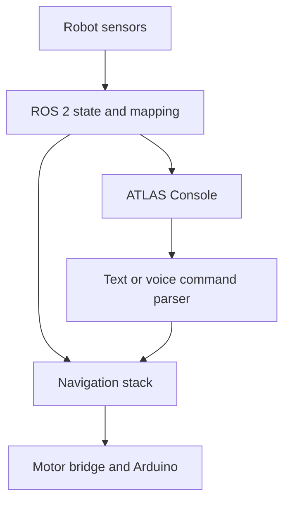

# ATLAS Autonomous Robot

Team robotics summer project by Vinayak Sharma, Yash Raj and Sampoorn Nagpal. The repository contains an Arduino motor-control layer, ROS 2 workspace, Nav2 configuration, mapping/semantic components and a voice subsystem. See the companion [ATLAS Console](https://github.com/thevinayak26/Atlas_Dashboard).

## Getting started and demo

Robot deployment depends on the team's actual Raspberry Pi, Arduino, sensors, ROS 2 Jazzy environment, device mappings and calibrated configuration. Follow team-approved deployment procedures rather than running startup scripts on an unrelated system. The safe off-robot demo is the [voice parser](voice/README.md), which provides typed-input/self-test examples; the dashboard repository offers a synthetic ROS-topic publisher for UI verification. Keep physical robot testing in a controlled supervised workspace.

## Evidence and evaluation

The robot contains [coverage benchmark code](ros2_ws/src/motor_bridge/motor_bridge/coverage_benchmark.py), but this documentation change does not claim benchmark results, autonomous success rates or verified robot hardware performance. The dashboard's simulator is a development stand-in, not a real-hardware capture.

## Individual contributions

- Yash Raj: [voice parser and destination controls](https://github.com/thevinayak26/AutonomousRobot/commit/0514f693b9887e059220152e2a3d8c5960735c83), [additional destination](https://github.com/thevinayak26/AutonomousRobot/commit/de591a9bac58488d9cb64da02d015805e1100d15), and [dashboard command integration](https://github.com/thevinayak26/Atlas_Dashboard/commit/170f19560164b3bb6486e55e1e861e799dd180bf).
- Other robot, mapping, navigation and motor-control components are team work. Individual attribution for those components should be reviewed by the team before publication.
